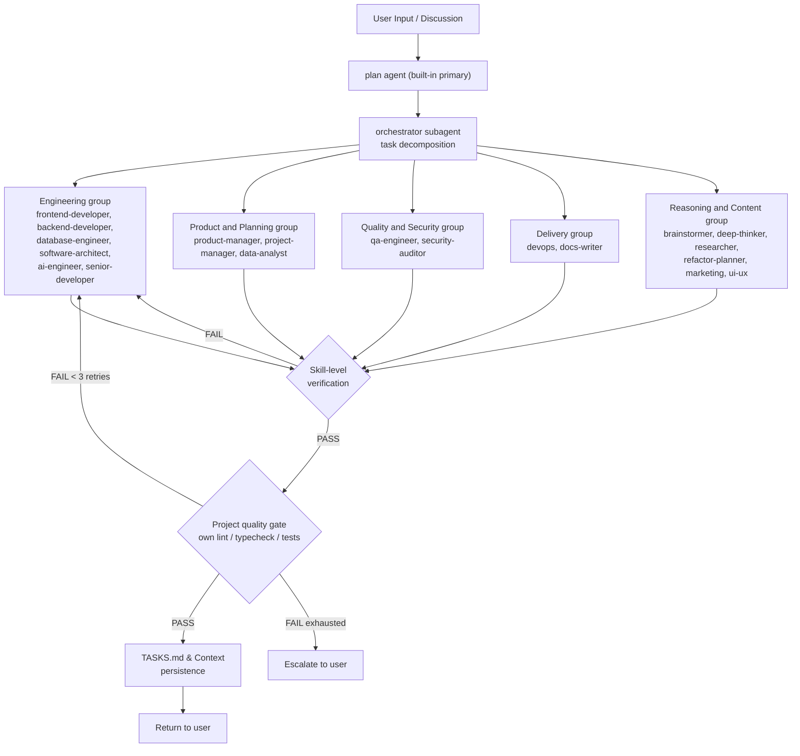
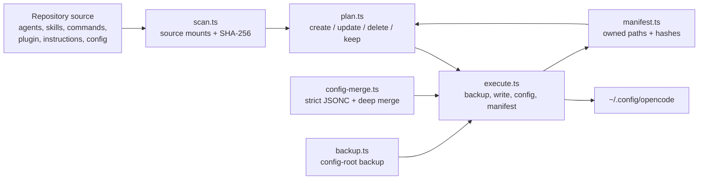

# Architecture

System architecture for the agent-skills Agent Orchestra.

---

## Overview

Agent Orchestra turns OpenCode into a multi-role development team. The primary `plan` agent interacts with the user for planning, while the `orchestrator` subagent coordinates work across specialized subagents using a verification loop, mimicking real-world engineering orgs.

**Key principles:**

- **Primary plan agent for user interaction** - default primary agent is `plan`
- **Orchestrator as coordinator** - delegates, does not do domain work directly
- **Subagents are focused** - each owns a domain (coding, product, data, QA, security, design, etc.)
- **Verification before delivery** - every result is verified before returning to the user
- **Progressive disclosure** - skills are loaded on-demand, not all at once
- **Agent-agnostic by layering** - the catalog is harness-neutral; only the integration layer assumes OpenCode (see Layering below)

---

## System Diagram

> Full detail for all 20 agents lives in the Agent Roster table below. The
> diagram is deliberately grouped by domain so it does not need updating
> every time the agent roster grows or shrinks.

---

## Agent Roster

> Canonical source: this table must list the same agents as the Agent Orchestra
> table in `AGENTS.md`. If they diverge, `AGENTS.md` wins - see the
> documentation-audit entry in DECISIONS.md.
>
> Key Skills per agent live in `AGENTS.md` only. This table does not repeat
> them, because a second copy can silently go stale.

| Agent | Mode | Role | Delegates To |
|---|---|---|---|
| **orchestrator** | subagent | Task decomposition, delegation, verification | All subagents via `task` tool |
| **frontend-developer** | subagent | UI implementation, components, client state, styling | - |
| **backend-developer** | subagent | API endpoints, business logic, auth, server-side integration | - |
| **software-architect** | subagent | System design, ADRs, trade-off analysis, architecture review | - |
| **database-engineer** | subagent | Schema design, migrations, indexing, query performance | - |
| **ai-engineer** | subagent | Prompt engineering, AI integration, RAG, structured output | - |
| **senior-developer** | subagent | Tech lead: cross-domain review, standards, glue work, hard debugging | - |
| **product-manager** | subagent | PRDs, feature specs, user stories, roadmap | - |
| **project-manager** | subagent | Project planning, milestone tracking, risk, status reports | - |
| **data-analyst** | subagent | SQL analysis, reporting, data profiling | - |
| **ui-ux** | subagent | Design system, frontend, accessibility | - |
| **marketing** | subagent | Content, SEO, copy, strategy | - |
| **qa-engineer** | subagent | Test strategy, coverage, quality gates | - |
| **devops** | subagent | CI/CD, deployment, infrastructure | - |
| **security-auditor** | subagent | Security review, auth, vulnerability assessment | - |
| **brainstormer** | subagent | Creative ideation, solution exploration | - |
| **deep-thinker** | subagent | Complex reasoning, root cause analysis | - |
| **researcher** | subagent | Technical research, comparisons, evidence-based recommendations | - |
| **docs-writer** | subagent | Technical writing, documentation | - |
| **refactor-planner** | subagent | Safe refactoring, legacy code migration | - |

---

## Layering (Agent Agnostic)

The project is structured in three layers so future harnesses other than OpenCode can be supported without forking the catalog:

| Layer | Contents | Coupling |
|---|---|---|
| Catalog (harness-neutral) | `skills/*/SKILL.md` (open Agent Skills format per agentskills.io), skill scripts/references/assets | No harness assumptions; portable to any agent runtime that reads SKILL.md |
| Integration (OpenCode-specific) | `agents/*.md` (OpenCode agent format with XML markup and V2 `permissions` arrays), `plugin/` hooks, `config/*.jsonc`, `commands/`, installer (`src/`) | Assumes OpenCode conventions; swappable per harness |

Adding support for a future harness (for example Claude Code, Codex CLI) means writing a new integration layer (agent format converter, plugin equivalent, installer target) while reusing the catalog untouched.

---

## Verification Loop

Workflow: `discussion to plan to orchestrator to test to implement to review to verify to remember to improve`

1. **Discussion** - user and agent clarify goals and requirements
2. **Plan** - built-in primary `plan` agent analyzes the request and creates a plan
3. **Decompose** - `orchestrator` subagent breaks down tasks into `TASKS.md`
4. **Delegate** - subtasks dispatched to specialized subagents via `task` tool
5. **Verify** - dual-layer quality gates (skill-level + project quality gate)
6. **Remember** - progress and decisions persisted to `TASKS.md`
7. **Return** - verified results delivered to user

---

## Installer Architecture

The installer converts this repository into a global OpenCode setup without
overwriting third-party files or user edits. It is OpenCode-only and writes
under the config root (default `~/.config/opencode/`). It never writes
`~/.agents/`.

| Module | Responsibility |
|---|---|
| `src/lib/install/scan.ts` | Maps repository sources to install paths, walks directories, and hashes file contents |
| `src/lib/install/targets.ts` | Resolves config and backup roots and enforces path containment |
| `src/lib/install/manifest.ts` | Validates, reads, and atomically writes `.agent-skills-manifest.json` |
| `src/lib/install/plan.ts` | Classifies each path as create, update, delete, or keep and reports conflicts |
| `src/lib/install/config-merge.ts` | Parses JSONC strictly, deep-merges config defaults, wires instructions, and migrates `subagent_depth` |
| `src/lib/install/execute.ts` | Runs the plan, writes configs, persists the manifest, and reports counts |

The planner never writes. `installCommand` aborts before execution when
replace or symlink mode sees an unmanaged conflict without `--force`, or when
a config cannot be parsed without `--force`. Backups run only when the plan
contains changes, and the manifest is written atomically after the files.

Config sources are the config-root files plus `OPENCODE_CONFIG` and
`OPENCODE_TUI_CONFIG`. Project-local cwd configs are not merged into the
global config. An existing `opencode.json` or `tui.json` is updated in place.

---

## Skills to Agent Mapping

The canonical per-agent assignment is the Key Skills column in the Agent Orchestra table in `AGENTS.md`. `tests/docs-consistency.test.ts` verifies that every agent's `<skills_to_load>` block matches that column and that every referenced skill directory exists.

This section deliberately does not repeat the mapping. A second copy would silently drift as agents and skills evolve; skill grouping by SDLC phase lives in `README.md`, and per-agent assignment lives only in `AGENTS.md`.

---

## Custom Tools

The project currently ships no custom tools; the plugin registers only hooks (see Plugin Hooks below). Tool history:

### task-decomposer.ts (removed)

Deprecated and deleted after the root-docs audit: its `inferAgent()` keyword routing covered only 5 of the 20 agents, which violates the hardcoded-routing-in-the-orchestrator-prompt decision. The underlying `skills/task-decomposition/scripts/task-decomposer.ts` remains as part of the skill.

### quality-verifier.ts (removed)

Removed on 2026-10-20: its file-level checks were language-specific (debug-statement scan for `console.log`/`debugger`/`print`, JSDoc-on-exports docstring scan, package.json plus bun/npm script checks) while the agent and skill catalog is advertised as language-agnostic, so every additional language would add patterns and false-positive tuning forever; each language's own tooling already does this better (eslint no-console, ruff, clippy, golangci-lint). The centralized verification layer now means the agent runs the project's own lint, typecheck, and test commands (see PRD FR-5). The wrapper `tools/quality-verifier.ts` and `tests/quality-verifier.test.ts` were deleted with it, and the installer no longer ships a `tools/` directory.

---

## Plugin Hooks

All hooks live in `plugin/` and are registered by the harness in `plugin/agent-skills.ts`.

### compaction.ts

Injects TASKS.md project state (Continue Here section) into the compaction prompt via `experimental.session.compacting`, so task progress survives context compaction.

### secrets-scanner.ts

Blocks write/edit tool calls whose string arguments contain likely secrets (AWS, GitHub, OpenAI, Anthropic, Stripe, Google, Slack, private key blocks, hardcoded credential assignments) via `tool.execute.before`. Throws before execution; placeholder values are ignored. Escape hatch: `AGENT_SKILLS_DISABLE_SECRETS_SCANNER=1`.

### tool-guardian.ts

Blocks irreversible destructive bash commands via `tool.execute.before`: recursive force deletes targeting filesystem roots, home, or wildcards - including glob forms (`rm -rf /*`, `~/*`, `$HOME/*`, `C:\*`), quoted home vars (`"$HOME"`, `"$env:USERPROFILE"`), and traversal forms that resolve to a root (`/.`, `/..`, `/tmp/..`) - in both short flags like `-rf` and GNU long forms like `--recursive --force`; Windows-native `del` / `rmdir` with `/s` plus `/q` or `/f` against those same targets; git force push (except `--force-with-lease` and safe variants like `--force-if-includes`); mkfs/fdisk/dd to devices/format; DROP TABLE/DATABASE/SCHEMA; chmod -R 777 on / or ~. Specific-path deletes and recoverable operations are allowed. Escape hatch: `AGENT_SKILLS_DISABLE_TOOL_GUARDIAN=1`.
