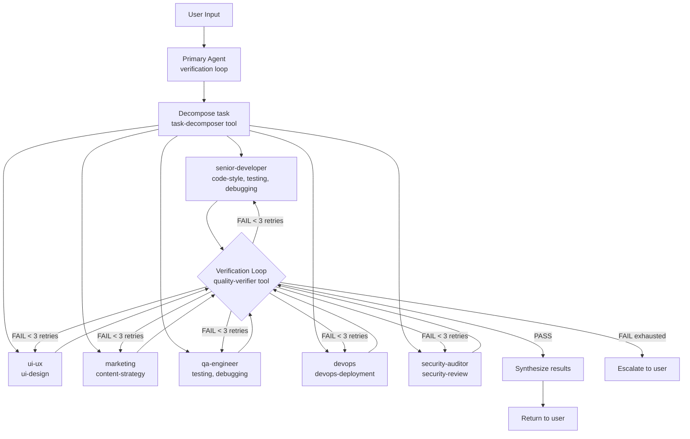

# Architecture

System architecture for the agent-skills Agent Orchestra.

---

## Overview

Agent Orchestra turns OpenCode into a multi-role development team. A primary agent orchestrates work across specialized subagents using a verification loop, mimicking real-world engineering orgs.

**Key principles:**

- **Primary as orchestrator** — delegates, does not do domain work directly
- **Subagents are focused** — each owns a domain (coding, QA, security, design, etc.)
- **Verification before delivery** — every result is verified before returning to the user
- **Progressive disclosure** — skills are loaded on-demand, not all at once

---

## System Diagram



---

## Agent Roster

| Agent | Mode | Role | Delegates To | Key Skills |
|---|---|---|---|---|
| **primary** | primary | Orchestrator with verification loop | All subagents via `task` tool | task-decomposition, quality-verifier |
| **senior-developer** | subagent | Architecture, coding, refactoring | - | code-style, debugging, testing, api-conventions, database, git-workflow, ai-integration |
| **ui-ux** | subagent | Design system, frontend, accessibility | - | ui-design |
| **marketing** | subagent | Content, SEO, copy, strategy | - | content-strategy |
| **qa-engineer** | subagent | Test strategy, coverage, quality gates | - | testing, debugging |
| **devops** | subagent | CI/CD, deployment, infrastructure | - | devops-deployment |
| **security-auditor** | subagent | Security review, auth, vulnerability assessment | - | security-review |
| **brainstormer** | subagent | Creative ideation, solution exploration | - | (none) |
| **deep-thinker** | subagent | Complex reasoning, root cause analysis | - | (none) |
| **docs-writer** | subagent | Technical writing, documentation | - | documentation, sdlc-documentation |
| **refactor-planner** | subagent | Safe refactoring, migration planning | - | planning |

Primary also delegates to OpenCode built-in subagents when the task fits better: `build` (clear implementation), `plan` (analysis only), `explore` (codebase search), `scout` (external research), `general` (generic multi-step).

---

## Verification Loop

1. **Analyze** the user's request - goal and required expertise
2. **Decompose** into subtasks using `todowrite` + `task-decomposer` tool
3. **Delegate** each subtask to the appropriate subagent via `task` tool
4. **Collect** results from all subagents
5. **Verify** by delegating to `qa-engineer`:
   - PASS: proceed to synthesis
   - FAIL (max 3 retries): send back to subagent with specific feedback
   - FAIL (exhausted): escalate to user with details
6. **Synthesize** verified results into final response
7. **Return** to user

Quality criteria verified: tests pass, typecheck passes, lint passes, no debug statements, all functions/classes have docstrings, error paths handled.

---

## Skills to Agent Mapping

| Skill | Used By | Purpose |
|---|---|---|
| task-decomposition | primary | Breaking down complex tasks |
| code-style | senior-developer | Code quality conventions |
| testing | senior-developer, qa-engineer | Test writing conventions |
| debugging | senior-developer, qa-engineer | Bug diagnosis workflow |
| api-conventions | senior-developer | API design consistency |
| database | senior-developer | Schema, queries, optimization |
| git-workflow | senior-developer | Git conventions |
| ai-integration | senior-developer | LLM/API integration |
| ui-design | ui-ux | Design system, frontend, accessibility |
| content-strategy | marketing | Content, SEO, copy, strategy |
| devops-deployment | devops | CI/CD, deployment, infrastructure |
| security-review | security-auditor | Security audit checklist |
| documentation | all | Writing docs |
| planning | all | System design, ERD, flows, diagrams |
| sdlc-documentation | all | PRD, SDD, requirements, test plans |

Skills follow progressive disclosure: `name` + `description` loaded at startup (~100 tokens), full `SKILL.md` when activated (under 5000 tokens), `references/` + `assets/` loaded on-demand only.

---

## Custom Tools

### task-decomposer.ts

Breaks a complex task description into structured subtasks.

- **Input:** `task` (string), optional `context` (string)
- **Output:** Array of `{id, description, suggestedAgent, dependencies}`
- **Agent inference:** keyword matching on description (test/qa, deploy/ci/cd, seo/content, ui/ux/design, security/auth, default senior-developer)
- **Used by:** primary agent

### quality-verifier.ts

Verifies code quality against defined criteria.

- **Input:** `files` (string[]), optional boolean flags: `checkLint`, `checkTypecheck`, `checkTests`, `checkNoDebug`, `checkDocstrings`
- **Output:** `{pass: boolean, details: {criterion, passed, message}[]}`
- **Used by:** primary agent (via qa-engineer subagent)

---

## Directory Structure

```text
agent-skills/
├── AGENTS.md                        # Project-level agent instructions
├── DECISIONS.md                     # Architectural decisions, conventions, known issues
├── ARCHITECTURE.md                  # System architecture (this file)
├── TASKS.md                         # Roadmap and backlog
├── PRD.md                           # Product requirements
├── SPEC.md                          # Agent Skills spec reference
├── README.md                        # Overview and quick start
├── INSTALL.md                       # Setup guide
├── opencode.jsonc                   # Local OpenCode config
├── package.json
├── tsconfig.json
├── .gitignore
├── eslint.config.js
├── agents/                          # 11 agent definitions (source)
│   ├── primary.md
│   ├── senior-developer.md
│   ├── ui-ux.md
│   ├── marketing.md
│   ├── qa-engineer.md
│   ├── devops.md
│   ├── security-auditor.md
│   ├── brainstormer.md
│   ├── deep-thinker.md
│   ├── docs-writer.md
│   └── refactor-planner.md
├── skills/                          # 15 skill directories
│   ├── code-style/
│   ├── testing/
│   ├── debugging/
│   ├── api-conventions/
│   ├── database/
│   ├── git-workflow/
│   ├── documentation/
│   ├── planning/
│   ├── sdlc-documentation/
│   ├── security-review/
│   ├── ai-integration/
│   ├── task-decomposition/
│   ├── ui-design/
│   ├── content-strategy/
│   └── devops-deployment/
├── tools/                           # 2 custom tools
│   ├── task-decomposer.ts
│   └── quality-verifier.ts
├── commands/                        # 10 slash-command shortcuts
│   ├── ship.md
│   ├── fix.md
│   ├── plan.md
│   ├── review.md
│   ├── test.md
│   ├── commit.md
│   ├── docs.md
│   ├── explain.md
│   ├── brainstorm.md
│   └── security.md
├── instructions/                    # Global AGENTS.md source
│   └── AGENTS.md
├── config/                          # Global config templates
│   ├── opencode.jsonc
│   └── tui.jsonc
├── plugin/
│   └── agent-skills.ts             # Minimal plugin - registers agents/skills/tools
├── src/                             # CLI installer (not deployed)
├── scripts/                         # ESLint plugin (not deployed)
└── tests/
    └── validate-skills.test.ts
```

---

## Deployment Map

When installed, source files from this repo map to `~/.config/opencode/`:

| Source (repo) | Destination | Purpose |
|---|---|---|
| `instructions/AGENTS.md` | `AGENTS.md` | Global agent rules (read every session) |
| `config/opencode.jsonc` | `opencode.jsonc` | Global config (merged with existing MCP/LSP) |
| `config/tui.jsonc` | `tui.jsonc` | TUI config (merged) |
| `agents/*.md` | `agents/*.md` | 11 agent definitions |
| `skills/*/` | `skills/*/` | 15 skill directories |
| `tools/*.ts` | `tools/*.ts` | 2 custom tools |
| `commands/*.md` | `commands/*.md` | 10 slash commands |
| `plugin/agent-skills.ts` | `plugins/agent-skills.ts` | OpenCode plugin |

Root files (`AGENTS.md`, `DECISIONS.md`, `ARCHITECTURE.md`, `TASKS.md`, `PRD.md`, `SPEC.md`) are project-only — not deployed to global config.

---

## Config Flow

Instructions are loaded in order and merged:

1. **Global AGENTS.md** (`~/.config/opencode/AGENTS.md`) — always applies first
2. **Project AGENTS.md** (`AGENTS.md`) — project context and overrides
3. **DECISIONS.md** — architectural decisions, conventions, known issues
4. **ARCHITECTURE.md** — system design reference
5. **TASKS.md** — roadmap and backlog

Priority: Global > Project > Decisions > Architecture > Tasks.