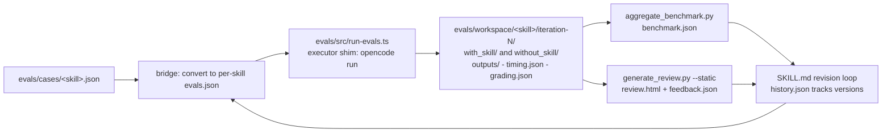

# Architecture

System architecture for the agent-skills Agent Orchestra.

---

## Overview

Agent Orchestra turns OpenCode into a multi-role development team. The primary `plan` agent interacts with the user for planning, while the `orchestrator` subagent coordinates work across specialized subagents using a verification loop, mimicking real-world engineering orgs.

**Key principles:**

- **Primary plan agent for user interaction** — default primary agent is `plan`
- **Orchestrator as coordinator** — delegates, does not do domain work directly
- **Subagents are focused** — each owns a domain (coding, product, data, QA, security, design, etc.)
- **Verification before delivery** — every result is verified before returning to the user
- **Progressive disclosure** — skills are loaded on-demand, not all at once
- **Agent-agnostic by layering** - the catalog is harness-neutral; only the integration layer assumes OpenCode (see Layering below)

---

## System Diagram

```mermaid
flowchart TD
    User[User Input / Discussion] --> Plan[plan agent (built-in primary)]
    Plan --> Orchestrator[orchestrator subagent<br/>task decomposition]

    Orchestrator --> Eng[Engineering group<br/>frontend-developer, backend-developer,<br/>database-engineer, software-architect,<br/>ai-engineer, senior-developer]
    Orchestrator --> Prod[Product and Planning group<br/>product-manager, project-manager, data-analyst]
    Orchestrator --> QAG[Quality and Security group<br/>qa-engineer, security-auditor]
    Orchestrator --> Ops[Delivery group<br/>devops, docs-writer]
    Orchestrator --> Think[Reasoning and Content group<br/>brainstormer, deep-thinker, researcher,<br/>refactor-planner, marketing, ui-ux]

    Eng --> SkillCheck{Skill-level<br/>verification}
    Prod --> SkillCheck
    QAG --> SkillCheck
    Ops --> SkillCheck
    Think --> SkillCheck

    SkillCheck -- PASS --> CentralCheck{Centralized<br/>quality-verifier}
    SkillCheck -- FAIL --> Eng

    CentralCheck -- PASS --> Remember[TASKS.md & Context<br/>persistence]
    CentralCheck -- FAIL < 3 retries --> Eng
    CentralCheck -- FAIL exhausted --> Escalate[Escalate to user]

    Remember --> Return[Return to user]
```

> Full detail for all 20 agents lives in the Agent Roster table below. The
> diagram is deliberately grouped by domain so it does not need updating
> every time the agent roster grows or shrinks.

---

## Agent Roster

| Agent | Mode | Role | Delegates To | Key Skills |
|---|---|---|---|---|
| **orchestrator** | subagent | Task decomposition, delegation, verification | All subagents via `task` tool | task-decomposition, quality-verifier |
| **frontend-developer** | subagent | UI implementation, components, client state, styling | - | ui-design, frontend-patterns, code-style, testing, debugging, git-workflow |
| **backend-developer** | subagent | API endpoints, business logic, auth, server-side integration | - | api-conventions, backend-patterns, code-style, testing, debugging, git-workflow |
| **software-architect** | subagent | System design, ADRs, trade-off analysis, architecture review | - | planning, architecture-decision, research-methodology, tech-debt |
| **database-engineer** | subagent | Schema design, migrations, indexing, query performance | - | database, database-migration, data-analysis, api-conventions, testing |
| **ai-engineer** | subagent | LLM prompt design, AI integration, RAG, structured output | - | prompt-design, structured-output, ai-integration, code-style, testing |
| **senior-developer** | subagent | Architecture, coding, refactoring | - | code-style, debugging, testing, api-conventions, database, git-workflow, planning, ai-integration |
| **product-manager** | subagent | PRDs, feature specs, user stories, roadmap | - | sdlc-documentation, task-decomposition, documentation |
| **project-manager** | subagent | Project planning, milestone tracking, risk management, status reporting | - | task-decomposition, planning, sdlc-documentation |
| **data-analyst** | subagent | SQL queries, schema analysis, data modeling | - | database, data-analysis, code-style |
| **ui-ux** | subagent | Design system, frontend, accessibility | - | ui-design |
| **marketing** | subagent | Content, SEO, copy, strategy | - | content-strategy, no-ai-slop |
| **qa-engineer** | subagent | Test strategy, coverage, quality gates | - | testing, debugging |
| **devops** | subagent | CI/CD, deployment, infrastructure | - | devops-deployment |
| **security-auditor** | subagent | Security review, auth, vulnerability assessment | - | security-review |
| **brainstormer** | subagent | Creative ideation, solution exploration | - | (none) |
| **deep-thinker** | subagent | Complex reasoning, root cause analysis | - | (none) |
| **researcher** | subagent | Technical research, tool and library comparison, evidence-based recommendations | - | research-methodology, planning |
| **docs-writer** | subagent | Technical writing, documentation | - | documentation, no-ai-slop, sdlc-documentation |
| **refactor-planner** | subagent | Safe refactoring, migration planning | - | planning |

---

## Layering (Agent Agnostic)

The project is structured in three layers so future harnesses other than OpenCode can be supported without forking the catalog:

| Layer | Contents | Coupling |
|---|---|---|
| Catalog (harness-neutral) | `skills/*/SKILL.md` (open Agent Skills format per agentskills.io), skill scripts/references/assets, eval cases | No harness assumptions; portable to any agent runtime that reads SKILL.md |
| Integration (OpenCode-specific) | `agents/*.md` (OpenCode agent format with XML markup), `tools/*.ts`, `plugin/` hooks, `config/*.jsonc`, `commands/`, installer (`src/`) | Assumes OpenCode v2 conventions; swappable per harness |
| Dev tooling (harness-neutral) | `evals/` (runner, cases, workspace, judge), `.agents/` vendored skill-creator and plugin-dev | Executor and judge are selectable via flags; no grading logic assumes a specific agent binary |

Adding support for a future harness (for example Claude Code, Codex CLI) means writing a new integration layer (agent format converter, plugin equivalent, installer target) while reusing the catalog and dev tooling untouched.

---

## Eval Pipeline

The evaluation pipeline follows the anthropics skill-creator methodology, bridged to this repo's centralized case format:



Key properties:

- **Executor shim:** vendored skill-creator scripts invoke `claude -p`; a shim maps this to `opencode run --model <pinned> --agent build --auto`. Grading logic upstream is unmodified.
- **Artifact contract** (per `references/schemas.md` in the vendored skill-creator):
  - Per run dir: `outputs/`, `timing.json` (`executor_duration_seconds`, `grader_duration_seconds`, `total_duration_seconds`), `grading.json` (`expectations[]` with `text/passed/evidence`, `summary` with `passed/failed/total/pass_rate`)
  - Per iteration: `benchmark.json` with exact field names `configuration.with_skill` / `configuration.without_skill`, each holding `pass_rate`, `time_seconds`, `tokens` objects with `mean` and `stddev`, plus `delta` strings; and scaffolded `feedback.json` for human review
  - Improve mode: `history.json` tracks `version`, `parent`, `expectation_pass_rate`, `grading_result` (baseline/won/lost/tie), `is_current_best`
- **Case mapping:** this repo's `assertions` map to skill-creator's `expectations`; `expected_output` maps to `expected_output` verbatim.

---

## Verification Loop

Workflow: `discussion -> plan -> orchestrator -> test -> implement -> review -> verify -> remember -> improve`

1. **Discussion** — user and agent clarify goals and requirements
2. **Plan** — built-in primary `plan` agent analyzes the request and creates a plan
3. **Decompose** — `orchestrator` subagent breaks down tasks into `TASKS.md`
4. **Delegate** — subtasks dispatched to specialized subagents via `task` tool
5. **Verify** — dual-layer quality gates (skill-level + centralized quality verifier)
6. **Remember** — progress and decisions persisted to `TASKS.md`
7. **Return** — verified results delivered to user

---

## Skills to Agent Mapping

| Skill | Used By | Purpose |
|---|---|---|
| task-decomposition | orchestrator | Breaking down complex tasks and TASKS.md tracking |
| code-style | senior-developer | Code quality conventions |
| testing | senior-developer, qa-engineer | Test writing conventions |
| debugging | senior-developer, qa-engineer | Bug diagnosis workflow |
| api-conventions | senior-developer | API design consistency |
| database | senior-developer, data-analyst | Schema, queries, optimization |
| data-analysis | data-analyst | SQL queries, data modeling, dataset analysis |
| research-methodology | researcher | Technical research, comparisons, evidence-based recommendations |
| git-workflow | senior-developer | Git conventions, branch naming, Conventional Commits |
| ai-integration | senior-developer | LLM/API integration |
| ui-design | ui-ux | Design system, frontend, accessibility |
| content-strategy | marketing | Content, SEO, copy, strategy |
| no-ai-slop | marketing, docs-writer | Removing AI slop patterns from prose while preserving voice |
| devops-deployment | devops | CI/CD, deployment, infrastructure |
| security-review | security-auditor | Security audit checklist |
| documentation | all | Writing docs |
| planning | all | System design, ERD, flows, diagrams |
| sdlc-documentation | product-manager, docs-writer | PRD, SDD, requirements, test plans |

---

## Custom Tools

### task-decomposer.ts

Breaks a complex task description into structured subtasks.

- **Input:** `task` (string), optional `context` (string)
- **Output:** Array of `{id, description, suggestedAgent, dependencies}`
- **Agent inference:** keyword matching on description
- **Used by:** orchestrator agent

### quality-verifier.ts

Verifies code quality against defined criteria.

- **Input:** `files` (string[]), optional boolean flags: `checkLint`, `checkTypecheck`, `checkTests`, `checkNoDebug`, `checkDocstrings`
- **Output:** `{pass: boolean, details: {criterion, passed, message}[]}`
- **Used by:** orchestrator agent (via qa-engineer subagent)

---

## Plugin Hooks

All hooks live in `plugin/` and are registered by the harness in `plugin/agent-skills.ts`.

### compaction.ts

Injects TASKS.md project state (Continue Here section) into the compaction prompt via `experimental.session.compacting`, so task progress survives context compaction.

### secrets-scanner.ts

Blocks write/edit tool calls whose string arguments contain likely secrets (AWS, GitHub, OpenAI, Anthropic, Stripe, Google, Slack, private key blocks, hardcoded credential assignments) via `tool.execute.before`. Throws before execution; placeholder values are ignored. Escape hatch: `AGENT_SKILLS_DISABLE_SECRETS_SCANNER=1`.

### tool-guardian.ts

Blocks irreversible destructive bash commands via `tool.execute.before`: recursive force deletes of filesystem roots, home, or wildcards; git force push (except `--force-with-lease`); mkfs/fdisk/dd to devices/format; DROP TABLE/DATABASE/SCHEMA; chmod -R 777 on / or ~. Specific-path deletes and recoverable operations are allowed. Escape hatch: `AGENT_SKILLS_DISABLE_TOOL_GUARDIAN=1`.
