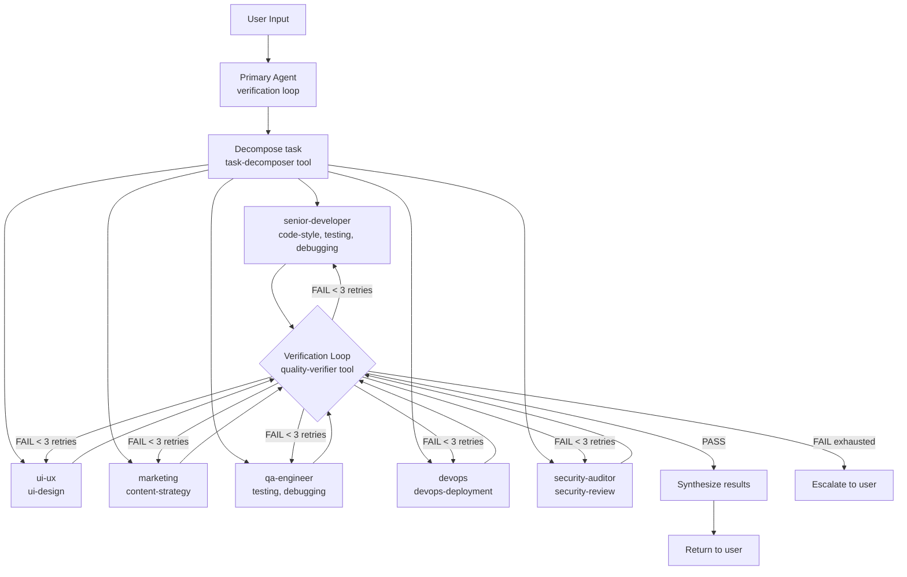

# PRD: agent-skills — Agent Orchestra for OpenCode

## 1. Problem Statement

The agent-skills project previously focused on a TypeScript plugin that syncs skills and agents to the user's OpenCode config directory. This approach duplicated OpenCode's built-in discovery mechanisms (`.opencode/agents/`, `.opencode/tools/`, `~/.config/opencode/skills/`) and required complex installer logic (`src/`) that is better handled by OpenCode itself.

The new direction: **Agent Orchestra** — a curated collection of specialized agents, skills, and custom tools that turn OpenCode into a multi-role development team. The primary agent delegates to sub-agents via verification loops, mimicking real-world engineering orgs.

## 2. Goals

- Provide a **primary agent** with a verification loop: decompose → delegate → collect → verify → iterate.
- Ship **real-world agency roles**: senior-developer, ui-ux, marketing, qa-engineer, devops, security-auditor.
- Provide **skills** that support each agent role with deep, role-specific guidance.
- Provide **custom tools** under `.opencode/tools/` that agents can use.
- Eliminate `src/` — no installer, no config manipulator, no MCP auto-config.
- Keep plugin minimal: only register agents/skills/tools, no file sync logic.
- Full OpenCode v2 compliance: agents as markdown, skills as SKILL.md, custom tools as TypeScript.
- PRD.md is the single source of truth for architecture decisions.

## 3. Target Users

- OpenCode users who want a multi-agent development workflow.
- Developers who want specialized agents (senior developer, UI/UX, QA, DevOps, marketing, security) at their fingertips.
- Teams that practice verification loops and quality gates before shipping.

## 4. Architecture



## 5. Agent Roster

| Agent                | Mode       | Role                                  | Delegates To                   | Key Skills                                                              |
| -------------------- | ---------- | ------------------------------------- | ------------------------------ | ----------------------------------------------------------------------- |
| **primary**          | `all`      | Main interface with verification loop | All sub-agents via `task` tool | task-decomposition, quality-verifier                                    |
| **senior-developer** | `subagent` | Architecture, coding, refactoring     | —                              | code-style, debugging, testing, api-conventions, database, git-workflow |
| **ui-ux**            | `subagent` | Design system, frontend, a11y         | —                              | ui-design                                                               |
| **marketing**        | `subagent` | Content, SEO, copy, strategy          | —                              | content-strategy                                                        |
| **qa-engineer**      | `subagent` | Test strategy, coverage, quality      | —                              | testing, debugging                                                      |
| **devops**           | `subagent` | CI/CD, deployment, infra              | —                              | devops-deployment                                                       |
| **security-auditor** | `subagent` | Security review, auth, vulns          | —                              | security-review                                                         |

## 6. Directory Structure

```text
agent-skills/
├── PRD.md                              # Source of truth
├── AGENTS.md                           # Project-level instructions
├── opencode.jsonc                      # Config with agent block
├── package.json
├── tsconfig.json
├── .gitignore
├── .opencode/
│   ├── agents/                         # Auto-discovered by OpenCode
│   │   ├── primary.md
│   │   ├── senior-developer.md
│   │   ├── ui-ux.md
│   │   ├── marketing.md
│   │   ├── qa-engineer.md
│   │   ├── devops.md
│   │   └── security-auditor.md
│   └── tools/                          # Custom tools (auto-discovered)
│       ├── task-decomposer.ts
│       └── quality-verifier.ts
├── agents/                             # Source of truth (copied to .opencode/agents/)
│   ├── primary.md
│   ├── senior-developer.md
│   ├── ui-ux.md
│   ├── marketing.md
│   ├── qa-engineer.md
│   ├── devops.md
│   └── security-auditor.md
├── skills/
│   ├── code-style/SKILL.md
│   ├── testing/SKILL.md
│   ├── debugging/SKILL.md
│   ├── api-conventions/SKILL.md
│   ├── database/SKILL.md
│   ├── git-workflow/SKILL.md
│   ├── documentation/SKILL.md
│   ├── planning/SKILL.md
│   ├── sdlc-documentation/SKILL.md
│   ├── security-review/SKILL.md
│   ├── ai-integration/SKILL.md
│   ├── task-decomposition/SKILL.md
│   ├── ui-design/SKILL.md
│   ├── content-strategy/SKILL.md
│   └── devops-deployment/SKILL.md
├── plugin/
│   └── agent-skills.ts                 # Minimal — only registers agents/skills/tools
└── tests/
    └── validate-skills.test.ts
```

## 7. Verification Loop

The primary agent implements a verification loop for every delegation:

```text
1. RECEIVE task from user
2. DECOMPOSE into subtasks (uses task-decomposer custom tool)
3. For each subtask:
   a. DELEGATE to appropriate subagent via `task` tool
   b. COLLECT result
   c. VERIFY quality (uses quality-verifier custom tool)
      - If PASS: proceed
      - If FAIL (max 3 retries): send back to subagent with feedback
      - If FAIL (exhausted): escalate to user
4. SYNTHESIZE all results into final response
5. RETURN to user
```

## 8. Skills → Agent Mapping

| Skill              | Used By                       | Purpose                       |
| ------------------ | ----------------------------- | ----------------------------- |
| task-decomposition | primary                       | Breaking down complex tasks   |
| code-style         | senior-developer              | Code quality conventions      |
| testing            | senior-developer, qa-engineer | Test writing conventions      |
| debugging          | senior-developer, qa-engineer | Bug diagnosis workflow        |
| api-conventions    | senior-developer              | API design consistency        |
| database           | senior-developer              | Schema, queries, optimization |
| git-workflow       | senior-developer              | Git conventions               |
| ui-design          | ui-ux                         | Design system, frontend, a11y |
| content-strategy   | marketing                     | Content, SEO, copy, strategy  |
| devops-deployment  | devops                        | CI/CD, deployment, infra      |
| security-review    | security-auditor              | Security audit checklist      |
| documentation      | all                           | Writing docs                  |
| planning           | all                           | System design, ERD, flows     |
| sdlc-documentation | all                           | PRD, SDD, requirements        |
| ai-integration     | senior-developer              | LLM/API integration           |

## 9. Relationship with OpenCode Built-in Agents

| OpenCode Built-in    | Our Addition          | Relation                                    |
| -------------------- | --------------------- | ------------------------------------------- |
| `build` (primary)    | —                     | Default dev agent, keep as-is               |
| `plan` (primary)     | —                     | Analysis agent, keep as-is                  |
| `general` (subagent) | —                     | Generic helper, keep as-is                  |
| `explore` (subagent) | —                     | Codebase explorer, keep as-is               |
| `scout` (subagent)   | —                     | External research, keep as-is               |
| —                    | `primary` (mode: all) | Verification loop agent, selectable via Tab |
| —                    | `senior-developer`    | Architecture & coding specialist            |
| —                    | `ui-ux`               | Design & frontend specialist                |
| —                    | `marketing`           | Content & SEO specialist                    |
| —                    | `qa-engineer`         | Testing & quality specialist                |
| —                    | `devops`              | CI/CD & deployment specialist               |
| —                    | `security-auditor`    | Security review specialist                  |

Our agents **complement** built-in agents. Users can Tab between `build`, `plan`, and `primary`.

## 10. Custom Tools

Tools in `.opencode/tools/` are auto-discovered by OpenCode v2.

### task-decomposer.ts

- **Purpose**: Break a complex task description into structured subtasks
- **Input**: Task description string
- **Output**: Array of subtask objects with {id, description, suggestedAgent, dependencies}
- **Used by**: primary agent

### quality-verifier.ts

- **Purpose**: Verify code quality against defined criteria
- **Input**: File paths, criteria (lint pass, tests pass, typecheck pass)
- **Output**: Pass/fail with details on what failed
- **Used by**: primary agent

## 11. Out of Scope

- MCP server auto-configuration
- opencode.jsonc permissions auto-write
- Instructions URL auto-write
- GitHub Actions CI changes (kept as-is)
- Any installer or sync logic beyond plugin registration
- Shell installer scripts

## 12. Changelog

| Version | Date | Changes                                                                          |
| ------- | ---- | -------------------------------------------------------------------------------- |
| 0.2.0   | TBD  | Rewrite: Agent Orchestra with verification loop, new agents/skills, removed src/ |
