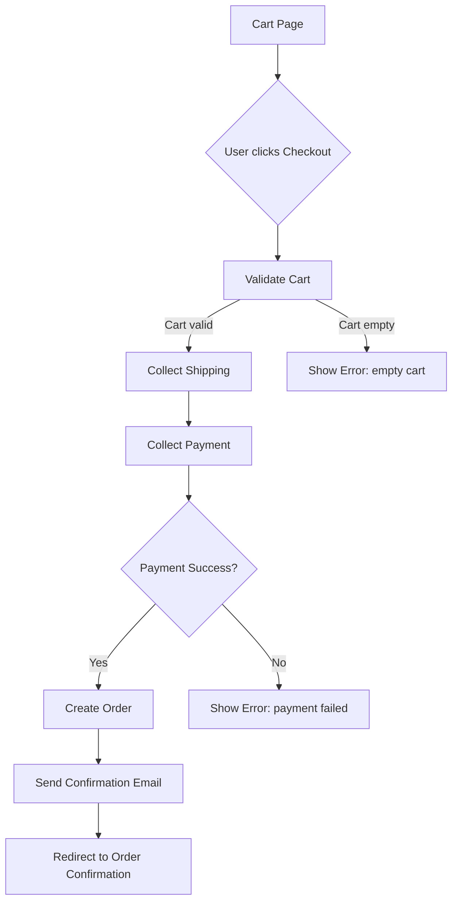

# Planning

Structured approach for creating technical design artifacts before building.
Always design before you build — a 30-minute design session prevents hours of rework.

---

## Examples

### Input: "Design the order checkout flow"

Mermaid `flowchart TD`:



---

## When to Use This Skill

| Request                        | Artifact               | Format                    |
| ------------------------------ | ---------------------- | ------------------------- |
| "Design the database"          | ERD                    | Mermaid `erDiagram`       |
| "How should this flow?"        | Flowchart or user flow | Mermaid `flowchart TD`    |
| "Design the system"            | Architecture diagram   | Mermaid `graph TD`        |
| "Map out the sequence"         | Sequence diagram       | Mermaid `sequenceDiagram` |
| "Show component relationships" | Component diagram      | Mermaid `graph LR`        |

All diagrams use **Mermaid.js** syntax — renders in GitHub, GitLab, Notion, and most documentation tools.

> For PRD, SDD, user stories, MVP scope, or timelines → use `sdlc-documentation` instead.

---

## References

- `references/erd.md` — ERD notation with PK, UK, FK, IDX and Mermaid syntax
- `references/flowchart.md` — flowchart and user flow with Mermaid `flowchart TD`
- `references/architecture.md` — system and component diagrams with Mermaid `graph` and `sequenceDiagram`
- `references/sequence.md` — sequence diagram patterns and examples

See `assets/` for diagram templates ready to fill in.

---

## Technical Design Checklist

```
- [ ] All diagrams use Mermaid.js syntax
- [ ] ERD completed if any data storage is involved
- [ ] All key types defined (PK, UK, FK, IDX)
- [ ] UK added for every field with a business uniqueness constraint
- [ ] Flowcharts cover happy path AND all error paths
- [ ] Architecture shows all components and communication protocols
- [ ] All external dependencies identified
- [ ] Single points of failure identified
- [ ] Sequence diagrams show both sync and async flows
- [ ] Design reviewed before implementation starts
```
