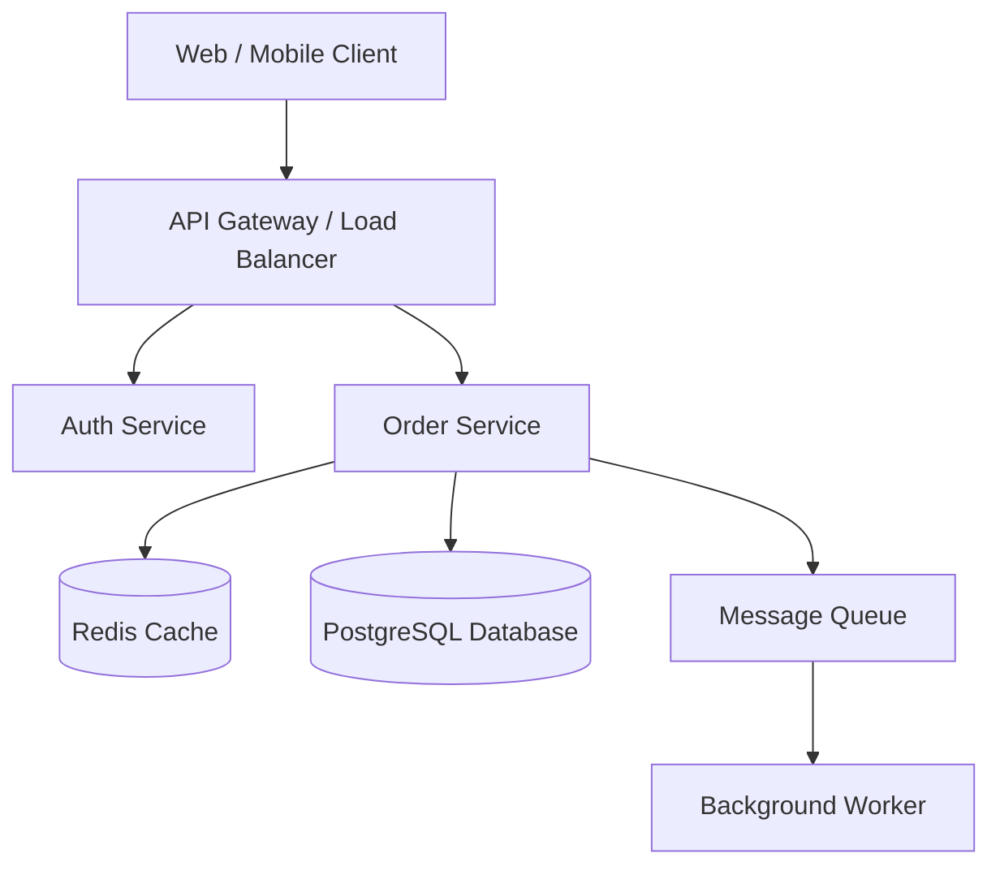

# System Design

Framework for designing systems, evaluating architectural decisions, and modeling component interactions.

---

## Design Framework

### 1. Requirements Gathering
- **Functional Requirements**: What the system must do.
- **Non-Functional Requirements**: Scale, latency, availability, consistency, cost.
- **Constraints**: Timeline, team familiarity, existing tech stack.

### 2. High-Level Design
- Component diagrams and service boundaries (using Mermaid.js `graph TD`).
- Data flow and communication protocols (REST, gRPC, WebSockets, Pub/Sub).
- Storage engine choices (Relational, KV, Document, Time-series).

### 3. Deep Dive
- Data model and schema design.
- API contracts and endpoint design.
- Caching strategy and queue/event handling.
- Error handling, retries, and circuit breakers.

### 4. Scale & Reliability
- Load estimation and capacity planning.
- Horizontal vs. vertical scaling.
- Failover, redundancy, monitoring, and alerting.

### 5. Trade-off Analysis
Explicitly document complexity, cost, time-to-market, and maintainability trade-offs.

---

## Example Component Diagram



---

## Verification Checklist

```markdown
- [ ] Functional and non-functional requirements documented
- [ ] Component diagram rendered in Mermaid.js syntax
- [ ] Data storage and communication protocols defined
- [ ] Failover and scaling strategy addressed
- [ ] Explicit trade-off analysis provided
```
